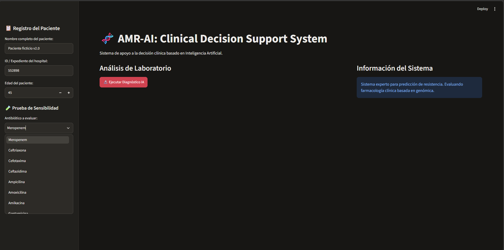
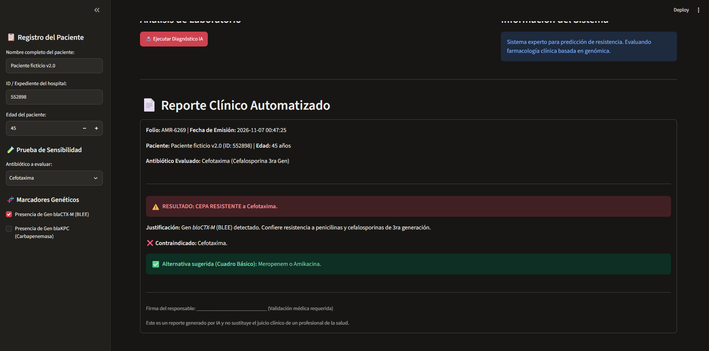
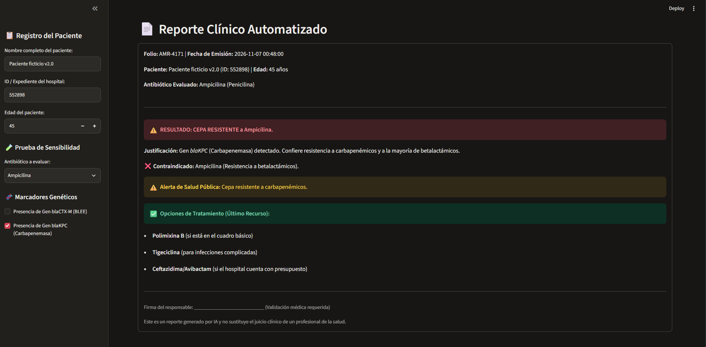

# 🧬 AMR-AI: Clinical Web App

A Clinical Decision Support System (CDSS) designed to combat Antimicrobial Resistance (AMR). This web application allows healthcare professionals to input patient data, evaluate genetic resistance markers (such as *blaCTX-M* and *blaKPC*), and generate automated, printable clinical reports based on the hospital's formulary.

## 🚀 Features
1. **AI-Powered Predictions:** Uses a Random Forest model trained on 90,000+ clinical records to predict resistance.
2. **Clinical Logic Integration:** Applies real-world pharmacological rules (e.g., if ESBL is detected, avoid 3rd-gen cephalosporins).
3. **Automated Reports:** Generates a structured clinical report with patient ID, date, time, and AI recommendations, ready for medical validation and printing.
4. **Hospital Formulary Simulation:** Adapts antibiotic recommendations based on the specific resources available at different hospitals.

## 📸 Screenshots

**1. Main Interface (Patient Input & Genetic Markers)**

**2. Clinical Report: ESBL (blaCTX-M) Alert**

**3. Clinical Report: Carbapenemase (blaKPC) Alert**

## 🛠️ Technologies Used
* Python 3
* Pandas & Scikit-Learn (Data Processing & Machine Learning)
* Streamlit (Web Interface)
* Joblib (Model Serialization)

## 💻 How to Run
1. Clone this repository.
2. Install dependencies: `pip install pandas scikit-learn streamlit`
3. Run the app: `python -m streamlit run app_web.py`
